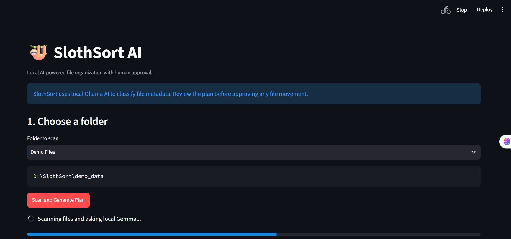
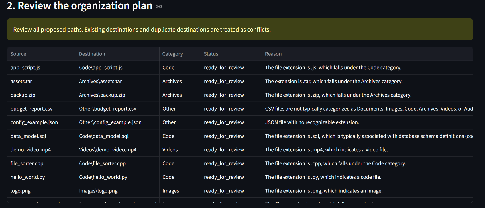
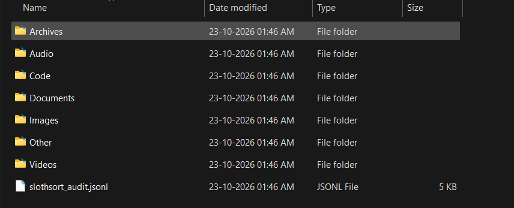

# 🦥 SlothSort AI

**Local AI-Powered File Organizer with Human Approval**

SlothSort is a Python-based file organization tool that uses a locally running AI model through Ollama to classify files using their metadata and suggest an organized folder structure. Users can review the proposed changes before approving file movement.

## 📸 Screenshots

### 1. Dashboard


### 2. AI Organization Preview


### 3. Organization Result


## ✨ Features

- 🤖 Local AI-powered file classification using Ollama and Gemma
- 📁 Automatic categorization into Documents, Images, Code, Archives, Videos, Audio, and Other
- 👀 Preview proposed file movements before execution
- ✅ Human approval required before organizing files
- 🛡️ Path validation and destination conflict checks
- 🧾 JSONL audit log for file operations
- 🧪 Automated tests using pytest
- 🔒 File metadata-based classification without sending files to a cloud AI service

## 🛠️ Tech Stack

- Python
- Streamlit
- Ollama
- Gemma 3
- Pytest
- Git

## 📂 Project Structure

```text
SlothSort/
├── src/
│   ├── app.py
│   ├── scanner.py
│   ├── ai_planner.py
│   └── executor.py
├── tests/
│   ├── test_scanner.py
│   └── test_executor.py
├── demo_data/
├── docs/
│   └── screenshots/
│       ├── 1.png
│       ├── 2.png
│       └── 3.png
├── .gitignore
├── LICENSE
├── README.md
└── requirements.txt
```

## ⚙️ Prerequisites

- Python 3.10 or newer
- Ollama installed and running
- Git

## 🚀 Installation and Setup

### 1. Clone the repository

```bash
git clone https://github.com/Shubhamkumar-op/SlothSort.git
cd SlothSort
```

### 2. Create and activate a virtual environment

**Windows PowerShell**

```powershell
python -m venv .venv
.\.venv\Scripts\Activate.ps1
```

### 3. Install dependencies

```bash
pip install -r requirements.txt
```

### 4. Download the local AI model

```bash
ollama pull gemma3:4b
```

Ensure Ollama is running before launching the application.

### 5. Start SlothSort

```bash
streamlit run src/app.py
```

Open the local URL displayed in your terminal.

## 🧪 Run Tests

```bash
python -m pytest tests/ -v
```

## 🔐 Safety Design

- The AI generates suggestions; it does not directly execute file operations.
- The user must approve the organization plan.
- The application validates file paths and category names.
- Existing destination files and duplicate destinations are treated as conflicts.
- Actual file movement is restricted to the project's recognized demo folders.
- File operations are recorded in an audit log.

**Note:** Always test with sample files before using any file organizer on important data. The included demo files are intended for demonstration, not for testing actual document or media contents.

## 🔮 Future Improvements

- Improved classification for CSV, JSON, and additional file types
- Undo and recovery support
- Better duplicate-file detection
- Expanded automated security and execution tests
- Support for configurable file categories

## 📄 License

This project is licensed under the MIT License. See [LICENSE](LICENSE).

---

**Built as a local-AI project exploring safer, human-approved file organization.**